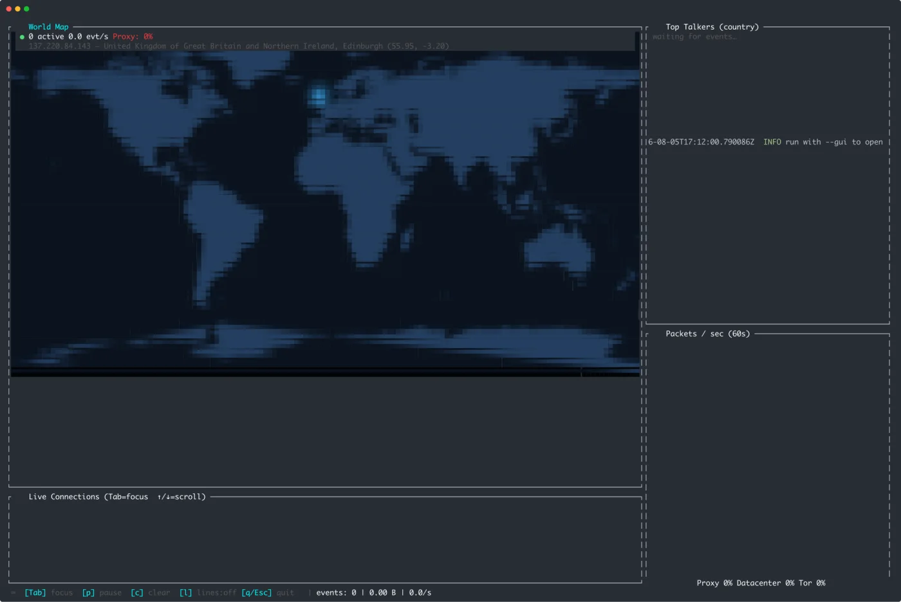
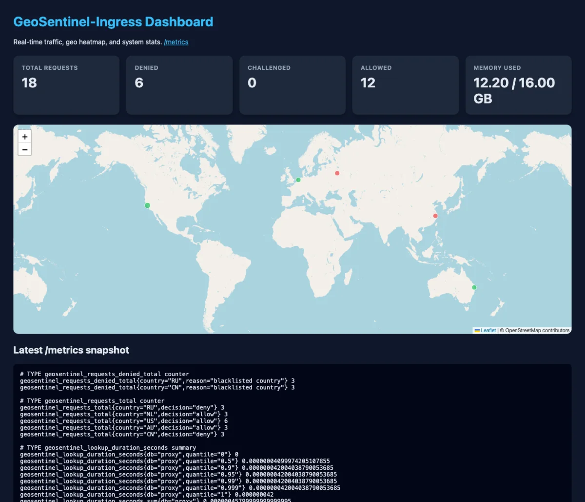

The 2026 IP2Location Programming Contest winners are out, and **geotop took first prize**. The award is USD $500 plus a two-year IP2Location.io Security Plan; the [winners page](https://contest.ip2location.com/winners) values the whole package at USD $12,476. Second and third went to [geotail](https://github.com/mattborja/geotail/) and [LocaSentinel](https://github.com/mardhiahnetwork/ip2location-sentinel).

The short version is easy: geotop won. This is the longer one. I went back through both repositories — 34 commits in `geotop`, one in `GeoSentinel-Ingress` — and reconstructed what actually happened between 3 and 9 August 2026: what was deliberate, what was discovered by breaking a release, and what I would change before the next tag.

The contest itself ran from 1 July to 30 September, so these six days sit early in the window rather than at the deadline.

## What geotop is

`geotop` is an `htop`-style monitor that watches raw network packets, nginx/Apache access logs, or both at once, and plots every connection on a live world map. It runs either in the terminal (`ratatui` + `ratatui-image`) or as a native window (`--gui`, eframe/egui).

| Piece | Implementation |
|---|---|
| Ingestion | `pnet` raw datalink capture **and** a Combined/Common Log Format tailer, feeding one normalized event stream |
| Enrichment | IP2Location LITE DB11 + IP2Proxy LITE PX11, mmap-backed lookups via `ip2location 0.6`, LRU-cached, hot-swappable |
| Terminal UI | `ratatui 0.30` + `ratatui-image 11`; auto-detects Kitty Graphics → Sixel → half-block |
| Native UI | `eframe 0.35` / `egui` on `wgpu`, with zoom, pan, hover details and scalable labels |
| Map | Bundled Natural Earth 110m land polygons, equirectangular projection, pulsing markers, animated arcs |
| Operations | Automatic DB download/extract, token persistence, live config reload, Homebrew cask, crates.io releases |



*The terminal build, using the half-block fallback so it works over SSH and in any terminal.*

One design decision shaped everything else: **both ingestion sources produce the same event type**. A sniffed packet and a parsed log line disagree about almost every field, but the UI should not care where a connection came from.

## Six days, 34 commits

| Date | Commits | What landed |
|---|---:|---|
| 3 Aug | 1 (other repo) | `GeoSentinel-Ingress` pushed as a single 5,038-insertion commit |
| 4 Aug, 22:50 | 1 | First `geotop` commit: 3,327 lines of Rust across ingestion, geo lookup, DB downloader, TUI and GUI — plus a 354-line README |
| 5 Aug | 2 | 843-line `config.rs`, vector map renderer (488 → 1,988 lines), home-location detection, screenshots, example config |
| 7 Aug | 27 | Release pipeline, animated arcs, map toggle, frame cap, token persistence, six tagged releases before midnight |
| 8–9 Aug | 4 | `0.1.7`, Homebrew `brew trust` docs, cask fixes, SonarCloud scan |

The first row is the companion repo; the remaining 34 commits are `geotop`'s. The public GitHub repository was created on 5 August at 18:08 UTC — a day after the first local commit. That is not a recommendation, just what the timestamps say.

Two things stand out in the history. First, the initial commit was not a sketch: it already contained the event bus, both ingest paths, the database downloader, the map renderer and both front-ends. The demo had to be runnable end to end before anything else was worth polishing. Second, the second commit is where the architecture got serious: `config.rs` arrived, the bundled SVG map was replaced with real GeoJSON geometry, and the renderer roughly quadrupled as viewport math, labels and tests moved in.

The arc of the week is easy to read in hindsight: make it work, make it configurable, make it installable, make it understandable to a stranger.

### Commits worth reading

If you want the shape of the work without the prose:

| Commit | What it shows |
|---|---|
| [`221680a`](https://github.com/ozkanpakdil/geotop/commit/221680a) | the end-to-end first build: both ingest paths, DB downloader, map, TUI and GUI |
| [`d420879`](https://github.com/ozkanpakdil/geotop/commit/d420879) | config, GeoJSON vector map, home detection, screenshots |
| [`79ed666`](https://github.com/ozkanpakdil/geotop/commit/79ed666) | the animated Bézier connection arcs |
| [`b8f9dc5`](https://github.com/ozkanpakdil/geotop/commit/b8f9dc5) | the Homebrew cask and the macOS notarization job |
| [`be34532`](https://github.com/ozkanpakdil/geotop/commit/be34532) | the keychain partition-list fix that let `codesign` run in CI |
| [`90b3edd`](https://github.com/ozkanpakdil/geotop/commit/90b3edd) | SonarCloud wiring, after the release dust settled |

## Architecture: two blocking producers, one event bus

```
  ┌──────────────────┐        ┌────────────────────┐
  │  pnet datalink   │        │  log tailer        │
  │  (own thread)    │        │  (own thread)      │
  └────────┬─────────┘        └─────────┬──────────┘
           │                            │
           └────────── mpsc ────────────┘
                          │
                  ConnectionEvent
                          │
              ┌───────────▼────────────┐
              │        AppState        │
              │  markers · log · stats │
              └─────┬────────────┬─────┘
                    │            │
               ratatui        eframe/egui
                    │            │
              ┌─────▼────────────▼─────┐
              │  MapRenderer (shared)  │
              │  base raster + dots    │
              └────────────────────────┘
```

Neither `pnet` nor `notify` is async-friendly, so both live on dedicated named threads and bridge into Tokio through an `mpsc::UnboundedSender<ConnectionEvent>`. The UI never blocks on a socket read or a regex.

`ConnectionEvent` is deliberately small: timestamp, source IP, destination port, protocol, HTTP status/method/path, user agent, byte count, source (`Pcap` or `Log`) and a severity. Severity is not decoration. Log lines escalate on status (4xx → warn, 5xx → alert); the sniffer escalates on destination port (22/3389/5900 → warn, 23/445/1433 → alert); and the app escalates any IP that reaches 30 hits to warn so a noisy scanner does not stay green.

`AppState` is the single writer for everything the UI reads. It keeps a FIFO of map markers (5,000 max, 8-second TTL by default), a 2,000-row log ring, per-IP counters, per-country counters and a 120-entry throughput ring. The caps are not incidental: they are what keeps a busy access log from turning into an out-of-memory event.

Geolocation sits behind an `ArcSwapOption<DB>`: lookups read the current `Arc` with no mutex, while a background tick checks the `.BIN` mtime every 60 seconds and swaps in a freshly loaded database. Results are cached in a 20,000-entry LRU keyed by `IpAddr`, because the renderer and the log panel both ask for the same IP on every event. Downloads are pure Rust — `reqwest` streaming plus the `zip` crate, no `curl`/`unzip` shell-outs — and the download token is persisted to the config file only after the database has been opened successfully, so a typo in a token cannot overwrite a working one. That last detail came directly from running the tool under `sudo`, which strips environment variables.

The home marker is detected the same way a user would do it manually: ask an IPv4 "what is my IP" endpoint, look that address up in the local database, fall back to configured coordinates if either step fails. It is best-effort by design; being offline should not stop the monitor from starting.

## The map is a third of the codebase

| Module | Lines today | Job |
|---|---:|---|
| `ui/map_renderer.rs` | 2,237 | projection, vector rasterization, markers, arcs, labels |
| `ui/gui.rs` | 1,033 | eframe window, zoom/pan, hover, GUI log |
| `config.rs` | 905 | typed config, defaults, hot reload |
| `main.rs` | 635 | CLI, DB/token setup, worker wiring, TUI loop |
| `db_downloader.rs` | 420 | download, extract, validate, hot-swap DBs |
| `ui/panels.rs` | 397 | htop-style panels and sparkline |
| `ui/app.rs` | 374 | TUI state, caps, counters |
| ingestion + lookup | ~800 | pcap, log tailer, event types, geo lookup |
| everything else | ~200 | home detection, layout, modules |

The renderer earns its size. The bundled map is 135 KB of Natural Earth 110m land polygons embedded with `include_bytes!`, so a release binary has no external assets and a crate install cannot silently fall back to a blank map. The geometry is rasterized with `tiny-skia` into a 2048×1024 equirectangular base; that projection makes latitude/longitude → pixel a two-line function, which matters because every marker, label and arc uses the same math.

Per frame the renderer copies the base, plots every live dot with a glow and an outer halo, fades it by age, pulses the home marker, then hands the buffer to `ratatui-image`. The GUI does not re-rasterize the world every frame either: viewport changes (zoom, pan) rebuild the base, while dots and arcs draw on top of the cached image.

The connection arcs were the fun part. Each arc is a quadratic Bézier whose control point is lifted north in proportion to distance, so short hops stay almost straight and long hops bow like flight paths. An ease-out cubic grows the arc over 0.7 seconds, with a bright head and a small box-blur glow. A cheap axis-aligned bounding-box test skips arcs that cannot intersect the viewport — but only after checking the box, not the target, so an arc to an off-screen node still draws its visible portion. Ten of the project's fifteen unit tests live in this file: projection sanity for known coordinates, country labels landing inside their polygons, marker styles writing pixels, and arcs still visible when the destination is off-screen.

The other five tests cover config parsing and event helpers. There is no UI snapshot testing; at this size, geometry tests bought more confidence per line than pixel diffs would have.

## Why Rust held up

Rust was not the point of the entry, but it is the reason the project fits in one binary and one event pipeline.

- **Ownership made the concurrency reviewable.** The packet sniffer, log tailer, database reloader and two front-ends are all long-lived and share state. Rust forces every one of those boundaries to be explicit: `ArcSwapOption<DB>` for lock-free database reads, `parking_lot::Mutex` around the caches, and no way to accidentally keep a borrowed packet buffer after the frame is gone.
- **No collector in the frame loop.** The renderer rewrites the RGBA map buffer every frame and reuses the allocation with a `copy_from_slice` blit. There is no garbage collector to introduce a pause in a tool whose whole job is to report time accurately.
- **The crates replaced subsystems.** `ratatui` and `ratatui-image` for the terminal, `eframe` for the window, `pnet` for capture, `ip2location` for the databases, `arc-swap` for hot reload, `reqwest` + `zip` for downloads, `cargo-release` + `git-cliff` for the release. Each one is a subsystem I would otherwise have written badly.
- **Distribution is a build target.** The same source builds for four release targets; the ingress goes further and links a static musl binary onto `scratch`. That is not a language feature by itself, but it is what the toolchain makes routine.

## Seven releases in seven hours

Versions 0.1.1 through 0.1.7 were tagged between 16:49 on 7 August and 00:05 on 8 August. That was not release discipline; it was me installing each artifact the way a stranger would and finding the next problem.

| What broke | Root cause | What shipped |
|---|---|---|
| Tag came out as `vv0.1.1` | `cargo-release` already prefixes `v` | Dropped the custom tag prefix |
| Linux release job failed | eframe/winit features and missing X11/Wayland dev libs | Enabled `x11`/`wayland`; installed only the FFI-linked libs |
| Intel macOS build had no runner | GitHub retired `macos-13` | Cross-compiled `x86_64-apple-darwin` on the arm64 runner |
| `cargo install geotop` failed on newer rustc | `zune-core 0.5.2` broke `zune-jpeg`; `cargo install` re-resolves deps | Pinned `zune-core = "=0.5.1"` |
| Debug build aborted on `--all-interfaces` (macOS) | `pnet 0.34` read `bpf_hdr` at a misaligned offset | Upgraded to `pnet 0.35` |
| Gatekeeper flagged the downloaded binary | Unsigned Mach-O | Universal2 build, Developer ID codesign, notarization |
| Token had to be re-supplied under `sudo` | `sudo` strips environment variables | Token persisted after a successful download |
| GUI uploaded a new map texture every vsync frame | Animation was uncapped | Added `gui_max_fps` |

The last one is the least dramatic and the most typical: the map looked great, and the GPU was uploading a new 2048×1024 texture every vsync frame. A frame cap is not a feature anyone asks for, but it is the difference between a demo and something you leave running.

The release workflow ended up with four jobs:

- **build** — a matrix of Linux x86_64, macOS arm64, macOS x86_64 and Windows MSVC. Windows needs the Npcap SDK headers; Linux needs `libpcap-dev`, `libwayland-dev` and `pkg-config`, and nothing else, because winit's X11 backend uses pure-Rust `x11rb` and the rest `dlopen` at runtime.
- **notarize-macos** — `lipo` the two Mach-Os into one universal binary, import the Developer ID certificate into a temporary keychain, codesign with the hardened runtime, submit with `notarytool --wait`, then package the tarball. Without the Apple secrets the job no-ops rather than blocking the release, so unsigned per-arch tarballs still ship.
- **release** — `git-cliff --latest --strip header` builds the notes from Conventional Commits, the cask's `version` and `sha256` are bumped in place and committed with the default `GITHUB_TOKEN`, then the GitHub Release is created.
- **publish-crate** — `cargo package`, verify the `.crate` tarball actually contains the GeoJSON, then publish. An "already exists" response is treated as success so rerunning a release is safe.

There is also a paranoid check in the build job: `grep` the compiled binary for `"type":"FeatureCollection"` and fail if it is missing. It sounds excessive until you remember that an asset present in the source tree is not necessarily present in the artifact.

Installing the result should be boring:

```bash
brew tap ozkanpakdil/geotop https://github.com/ozkanpakdil/geotop
brew trust ozkanpakdil/geotop
brew install --cask geotop

# or, with a Rust toolchain
cargo install geotop
```

The `brew trust` line is not optional on current Homebrew, and the explicit tap URL is needed because the shorthand `ozkanpakdil/geotop` resolves to a `homebrew-geotop` repository by convention. Both facts are in the README because both are easy to get wrong.

## GeoSentinel-Ingress: the companion that shipped first

`GeoSentinel-Ingress` is the other entry: an async ingress/reverse-proxy middleware that resolves the real client IP, enriches requests with IP2Location data, evaluates declarative security rules, and exports Prometheus metrics plus a small admin dashboard.



*The admin dashboard: request counters, memory, and a Leaflet heatmap fed by `/api/stats`.*

It is built on axum 0.7 / hyper 1 / tower, with a GeoShield middleware that runs before the proxy handler. For every request it resolves the client IP (`X-Forwarded-For`, then `X-Real-IP`, then the socket peer), does a geo lookup and a proxy lookup, injects four headers upstream, records histograms and counters, and then evaluates the rule chain:

1. `allow_countries` (if non-empty, anything else is denied),
2. `deny_countries`,
3. `proxy_action` / `deny_proxy_types`,
4. governor-based rate limits, per IP and optionally per country,
5. `default_action`.

Denied requests get 403 with the reason; `challenge` gets 401. The upstream sees `X-Geo-Country`, `X-Geo-City`, `X-Geo-Coordinates` and `X-Geo-Proxy-Type`, with the city sanitized to visible ASCII so a header can never carry control characters.

The rest of the service is deliberately small: a multi-stage Dockerfile that compiles a static musl binary and ships it on `scratch` (copying `rules.yaml` and `assets/admin.html`, because the admin page is read from disk at startup), a Prometheus recorder refreshed every five seconds, a `DashMap` of per-country allow/deny/challenge counters for `/api/stats`, and two Criterion benchmarks for lookups and rule evaluation.

The shared DNA with `geotop` is explicit in the code. `geotop`'s database manager says it is "modelled directly on the `DatabaseManager` from GeoSentinel-Ingress"; its Cargo manifest notes that `ip2location` is "kept in sync with GeoSentinel-Ingress 0.1"; and both use the same LITE DB filenames, the same `token=` download convention, pure-Rust zip extraction and `arc-swap` for hot reload. Building the ingress first meant the monitor inherited a database lifecycle that had already been made to work in a service.

The honest part: GeoSentinel has exactly one commit, `59ff933`, with 5,038 insertions across 22 files and the message "feat: implement configuration management and database handling". That message describes maybe a fifth of what landed. The code is readable; the history is not. `geotop`'s 34 mostly small commits are the reason this post can exist at all.

## What I would change before the next tag

A build log without the loose ends would be marketing. These are the ones I can see in the code today:

- **Unify the two UI states.** The TUI and GUI keep near-duplicate `AppState`/`GuiState` structs. That duplication is why the same cosmetic bug exists in both: the proxy-share gauge counts per-country keys starting with `~`, but those keys are never written that way, so it reads 0%. A shared core with two renderers would have prevented it.
- **Fix the throughput units.** `tick()` appends a bucket every 100 ms, so the 120-entry ring covers about twelve seconds, while the panel calls it "Packets / sec (60s)" and `events_per_sec` divides by the ring length. The shape is right; the units are not.
- **Do not trust `X-Forwarded-For` from every peer.** GeoShield takes the first parseable entry from any client. Behind a known proxy that is correct; exposed directly, it is spoofable. A trusted-proxy list is the missing guard.
- **Stream request bodies.** The proxy buffers the whole body with `to_bytes(..., usize::MAX)` before forwarding. Fine for JSON APIs, wrong for large uploads.
- **Run the tests in CI.** `build.yml` is a SonarCloud scan. The fifteen unit tests only run when I run them locally. A `fmt` + `clippy` + `test` job is the obvious next commit.
- **Add backpressure.** The event channel is unbounded; a traffic flood can queue faster than the UI drains. A bounded channel with sampling or aggregation would make the memory profile honest under attack.
- **Finish the packaging.** There is no `LICENSE` file even though both manifests declare `MIT OR Apache-2.0`, and GeoSentinel's `Cargo.toml` still points at `yourorg/geosentinel-ingress`.

None of these change the result of the contest. All of them are the difference between "works on my machine" and "I would run this on a server".

## What I think mattered

I cannot tell you what the judges weighted, and I would not guess. I can tell you where the time went, and the distribution is the lesson:

- **The first commit was end-to-end.** Not because planning is bad, but because a judge — or any user — needs to run the thing before they can care about the internals.
- **Much of the work was after the feature set.** Signing, notarization, the cask, the token prompts, the `sudo` notes, the Gatekeeper section. A repository is not a tool until a stranger can install it without reading your source.
- **Small commits paid twice.** Conventional Commits made `git-cliff` release notes possible, and the 34-commit history is the only reason this post can describe the week instead of just the final tree.
- **Tests around the risky math.** Projection and arc geometry are easy to get subtly wrong and hard to eyeball. The map tests were worth more than broader coverage would have been.

`geotop` is still the tool I wanted: point it at an interface or an access log, and watch the world light up. Winning first prize was a genuinely lovely surprise. Thank you to IP2Location for running the contest and for the LITE databases that make local, private geolocation possible.

## Links

- [`geotop`](https://github.com/ozkanpakdil/geotop) — source, releases, Homebrew cask
- [`geotop` on crates.io](https://crates.io/crates/geotop)
- [`GeoSentinel-Ingress`](https://github.com/ozkanpakdil/GeoSentinel-Ingress)
- [IP2Location Programming Contest 2026 winners](https://contest.ip2location.com/winners)
- [Contest home](https://contest.ip2location.com/)
